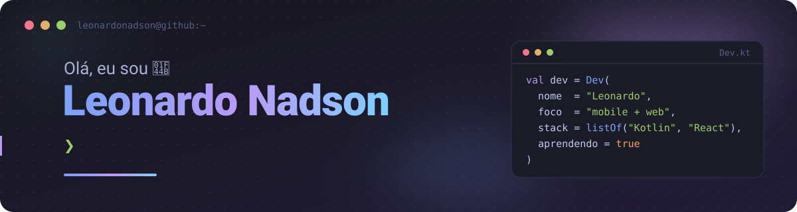
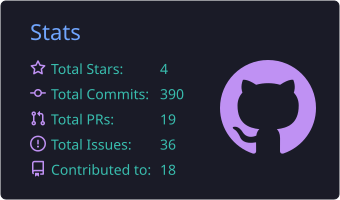
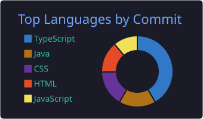

<div align="center">



<br />

<a href="https://portfolio-leonardo-nadson.vercel.app/"></a>
<a href="https://www.linkedin.com/in/leonardonadson/"></a>
<a href="mailto:leonardo.nom@outlook.com"></a>
<a href="https://drive.google.com/file/d/1rhbXiBcqoxKYf6kCWz4w3GhCto2qfMYX/view?usp=sharing"></a>

</div>

---

## 👨‍💻 Sobre mim

```kotlin
val leonardo = Dev(
    agora     = "Desenvolvedor Mobile @ Agiltec Soluções em TI",
    estudando = "Tecnologia da Informação — UFRN",
    foco      = listOf("mobile", "web full-stack"),
)
```

Gosto de transformar ideias em interfaces funcionais e bem estruturadas, do back-end até a tela do celular. Projetos, trajetória e experiências completas estão no **[meu portfólio](https://portfolio-leonardo-nadson.vercel.app/)**.

## 🛠️ Stack principal

<div align="center">


</div>

## 📊 GitHub em números

<div align="center">
  
  
  <br /><br />
  <picture>
    <source media="(prefers-color-scheme: dark)" srcset="https://raw.githubusercontent.com/leonardonadson/leonardonadson/output/github-snake-dark.svg" />
    <source media="(prefers-color-scheme: light)" srcset="https://raw.githubusercontent.com/leonardonadson/leonardonadson/output/github-snake.svg" />
    
  </picture>
</div>

---

<div align="center">

**Tem um projeto, uma vaga ou uma ideia? Bora conversar.** 🤝

</div>
